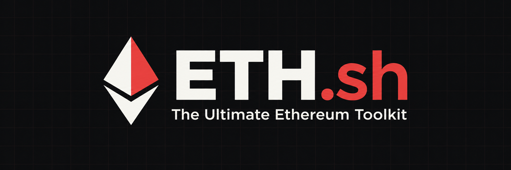

<a href="https://eth.sh/">
  
</a>

# ETH.sh

**The Ultimate Ethereum Toolkit**

[ETH.sh](https://eth.sh/) brings together tools for inspecting contracts, decoding calldata, sending transactions, and working across EVM chains, alongside directories for the Ethereum ecosystem.

Formerly **Swiss-Knife.xyz**, rebuilt with a new interface and expanded toolset. Each tool has a direct, bookmarkable URL, such as [calldata.eth.sh](https://calldata.eth.sh/decoder), [explorer.eth.sh](https://explorer.eth.sh/), and [tx.eth.sh](https://tx.eth.sh/).

[Explore all tools](https://eth.sh/#all-tools) · [Report a bug or request a feature](https://github.com/swiss-knife-xyz/swiss-knife/issues)

## Developer tools

| Tool | What it does |
| --- | --- |
| [Explorer](https://explorer.eth.sh/) | Inspect addresses and contracts, read and write functions, inspect storage, and open external explorers. |
| [Calldata](https://calldata.eth.sh/decoder) | Decode calldata without a supplied ABI, encode function calls, and inspect decoded parameters. |
| [Solidity Compiler](https://solidity.eth.sh/compiler) | Write, compile, and deploy Solidity contracts in the browser. |
| [Cross-explorer Verification](https://explorer.eth.sh/verify) | Verify contract source across Etherscan, Blockscout, Routescan, and Sourcify. |
| [Transact](https://tx.eth.sh/) | Send custom calldata and ETH, or deploy a contract from bytecode. |
| [Contract Diff](https://contract-diff.eth.sh/) | Compare deployed contract source code across addresses and chains. |
| [Wallet](https://wallet.eth.sh/bridge) | Connect dapps through WalletConnect, use DS Proxy and Coinbase Smart Wallet tools, and sign or verify messages and EIP-712 typed data. |
| [Web3 App Store](https://apps.eth.sh/) | Browse dapps with transaction decoding built into the wallet flow. |
| [Explorer Directory](https://eth.sh/explorers) | Find external explorers for an address, ENS name, or transaction across EVM chains. |
| [Uniswap](https://uniswap.eth.sh/tick-to-price) | Convert ticks and prices, calculate swaps, and work with Uniswap v4 pools, liquidity, and positions. |
| [Safe](https://safe.eth.sh/eip-712-hash) | Calculate Safe EIP-712 transaction hashes and decode Safe calldata. |
| [Mock Tokens](https://eth.sh/mock-tokens) | Deploy mock ERC-20, ERC-721, and ERC-1155 tokens for testing. |
| [Storage Slots](https://storage-slots.eth.sh/) | Read custom, EIP-1967, and ERC-7201 contract storage slots. |
| [RPC Console](https://eth.sh/rpc-console) | Make read-only JSON-RPC queries with request examples and formatted responses. |
| [IPFS Gateways](https://ipfs.eth.sh/) | Open IPFS CIDs and URLs through public gateways. |
| [ENS](https://ens.eth.sh/history) | Explore name history and visualize CCIP Read resolution. |
| [Converter](https://converter.eth.sh/eth) | Convert ether, gwei, wei, hex, decimal, and binary; calculate hashes, selectors, padding, checksums, and gas costs. |
| [Epoch Converter](https://epoch-converter.eth.sh/) | Convert Unix timestamps and dates, calculate relative times, and find Ethereum blocks by time. |
| [Determine Address](https://determine-address.eth.sh/) | Calculate contract addresses for CREATE and CREATE2 deployments. |
| [SIWE Validator](https://siwe.eth.sh/) | Validate, fix, sign, and share EIP-4361 Sign-In With Ethereum messages. |
| [Foundry](https://foundry.eth.sh/forge-stack-tracer-ui) | Explore Foundry stack traces in a collapsible tree. |
| [Character Counter](https://character-counter.eth.sh/) | Count characters in a string or selected text. |
| [Constants](https://constants.eth.sh/) | Copy common Ethereum constants, including the zero address and maximum integer values. |

## Payments, names, and token migration

| Tool | What it does |
| --- | --- |
| [Migrate Tokens](https://migrate.eth.sh/) | Transfer tokens to another address, batching transfers through ERC-5792 when supported. |
| [USDC Pay](https://usdc-pay.eth.sh/) | Create shareable USDC payment links on Base, with ENS, Basename, and Farcaster username resolution. |
| [Gwei Names](https://gwei.eth.sh/) | Register a .gwei name and migrate ENS website, avatar, and primary identity records. |
| [Robin Bridge](https://eth.sh/robin-bridge) | Set up LayerZero OFT routes, bridge Base tokens to Robinhood Chain, and add ETH liquidity. |

## Ecosystem directories

| Directory | What you can find |
| --- | --- |
| [7702Beat](https://7702beat.eth.sh/) | EIP-7702 adoption across chains, wallets, and dapps. |
| [Faucets](https://faucet.eth.sh/) | Testnet faucet sources and claim cooldown tracking. |
| [Web3 AI Skills](https://skills.eth.sh/) | Skills, MCP servers, CLIs, wallets, and other tools for onchain agents. |
| [Ethereum Orgs](https://eth.sh/orgs) | Foundations, labs, guilds, collectives, and adoption groups. |
| [Privacy Protocols](https://privacy.eth.sh/) | Privacy protocols compared by supported chains, assets, fees, and privacy model. |
| [R.I.P.](https://rip.eth.sh/) | Web3 project shutdowns, timelines, and original announcements. |

## Run locally

Built with **Next.js 16, React 19, TypeScript, Chakra UI, viem, and wagmi**.

The redesigned application is currently developed on `v2`. The previous site is preserved on [`swiss-knife-legacy`](https://github.com/swiss-knife-xyz/swiss-knife/tree/swiss-knife-legacy).

Use [nvm](https://github.com/nvm-sh/nvm) to select the Node version in [`.nvmrc`](.nvmrc), and pnpm 9.12.0 as declared in [`package.json`](package.json).

```bash
git clone --branch v2 https://github.com/swiss-knife-xyz/swiss-knife.git
cd swiss-knife
nvm install
nvm use
corepack enable
pnpm install
cp .example.env.local .env.local
pnpm dev
```

Open [localhost:3000](http://localhost:3000). Keep `NEXT_PUBLIC_DEVELOPMENT="true"` in `.env.local` so navigation uses local paths instead of production subdomains:

- `calldata.eth.sh/decoder` → `localhost:3000/calldata/decoder`
- `explorer.eth.sh/` → `localhost:3000/explorer`
- `tx.eth.sh/` → `localhost:3000/tx`

[`.example.env.local`](.example.env.local) lists environment variables for RPC providers, WalletConnect, explorer APIs, and other integrations. Configure the services needed for the tools you are working on; features that depend on missing credentials may be unavailable. Keep secrets in `.env.local`; `NEXT_PUBLIC_*` variables are exposed to the browser.

To build and serve the production bundle locally:

```bash
pnpm build
pnpm start
```

## Contributing

Bug reports, new tools, directory entries, and improvements to existing tools are welcome. [Open an issue](https://github.com/swiss-knife-xyz/swiss-knife/issues) to discuss a change or submit a pull request against `v2` while it remains the development branch.

- Read [`AGENTS.md`](AGENTS.md) for repository conventions, including page metadata and Open Graph images.
- Tool routes live in [`app/`](app/); homepage listings live in [`data/toolCatalog.ts`](data/toolCatalog.ts) and [`data/subdomainToInfo.ts`](data/subdomainToInfo.ts). Subdomain definitions live in [`subdomains.js`](subdomains.js).
- To add an external explorer, update [`data/addressExplorers.ts`](data/addressExplorers.ts) or [`data/txExplorers.ts`](data/txExplorers.ts).
- Before changing network support or RPC access, read [`_docs/networks.md`](_docs/networks.md). Shared network definitions live in [`data/networks.ts`](data/networks.ts).
- Run the tests relevant to your change and `pnpm exec tsc --noEmit`. Vitest configurations live in [`vitest/`](vitest/), and tool-specific test commands are listed in [`package.json`](package.json); shared network changes also require `pnpm test:networks`.

## License

[MIT](LICENSE.md)
